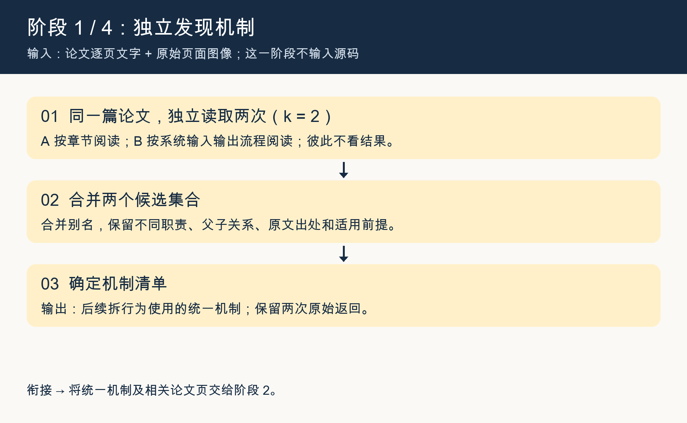
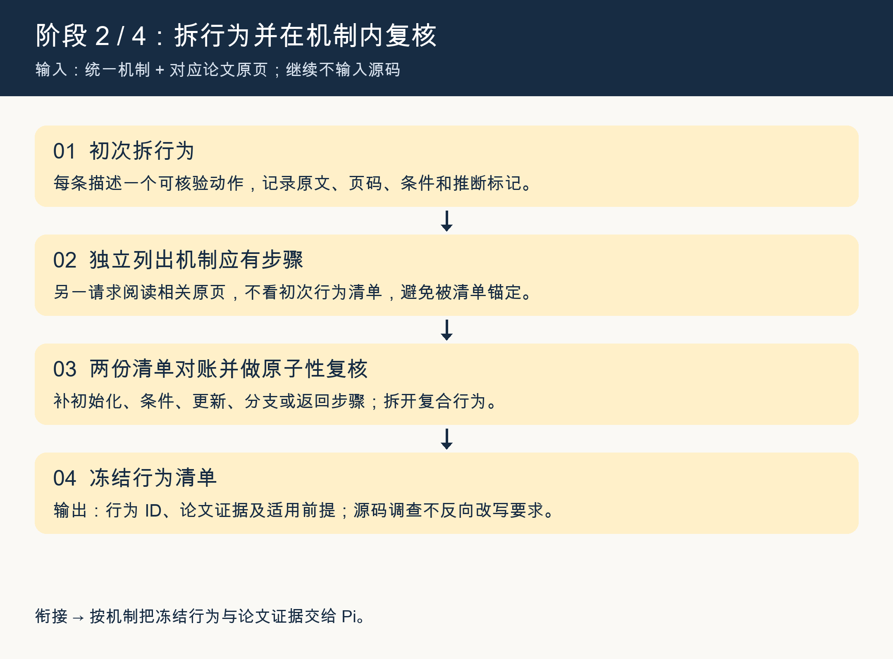

# 论文侧：Zhaopeng

**从论文出发，检查作者说会做的事情，代码是否实现。** 我负责论文语义拆解（步骤 1）和论文 → 代码静态核验（步骤 3a），不运行目标系统。

交接时先看本页；后续 agent 看 [`CLAUDE.md`](CLAUDE.md)；安装、复跑和接口细节看 [`HANDOFF.md`](HANDOFF.md)。

## 方法限制实验

这条研究线从论文的方法和固定版本的作者源码出发，找出在什么条件下算法的假设失效，以及可以用什么对照来检验。模型使用 SoCLaaS DeepSeek V4.1 Flash（max）。Shanghao 的参考答案只用于终稿评分。

目前开发的是**算法与评估证据的交叉核验**。一位 Pi worker 从算法入口追到下游消费，另一位从论文评估结果反查对应机制。主 agent 对照两份调查，回查关键证据，并在终稿说明触发条件、下游影响和可反驳的测试设计。早期的定向补证实验比较的是同一份草稿由主 agent 自查或由独立 agent 补证。

- **开发集**包括 NNSmith、MInference、InfiniGen 和 SparTA。
- **评估集**中有源码的四篇是 Prompt Cache、SpinQuant、KVQuant、DX100。另有四篇仅论文的案例，单独统计。
- **当前结果**是四篇 Dev 中，单 Pi agent 在 MInference 上部分命中，最新 Swarm 在 SparTA 上部分命中。两组均为 0 个核心命中。目前没有方法同时超过 A 和 B，评估集尚未开放。

[实验 README](tools/method-limitations/README.md) 有三种角色的职责、复跑命令、终稿评分和产物说明。下面的交接包用于论文声明与源码核验。

## 先拿什么

当前 FlexPrefill、NNSmith 在 `handoffs/paper-side-v2/<paper>/`；其余和历史结果在 `handoffs/paper-side-v1/<paper>/`。接手只需先看三个文件：

| 文件 | 用来做什么 |
|---|---|
| `paper_side.json` | 给 Wanting 的论文输入：声明、适用范围、实验配置、代码映射；传给 `codeside.verify3b --paper-side` |
| `conformance.json` | 查看每条论文行为的源码核验结果及依据 |
| `limitations.json` | 查看不符或未实现的静态差异候选，供后续整合和测试 |

源码片段、待办、修订记录也在同目录，需要追溯时再查。[完整文件说明与接入方法](HANDOFF.md#交给-wanting)。

## 本轮接口联调：schema 0.2.0

已对照 main `9fce6e0`，为 [FlexPrefill](handoffs/paper-side-v2/flexprefill/) 与 [NNSmith](handoffs/paper-side-v2/nnsmith/) 新建 v2 包。先看[两个完整输入输出案例](docs/parameter-mapping-cases.md)：τ → tau、Pool2d 的 kw/kh → kernel_w_size/kernel_h_size。

原生四数组接口保持不变，映射证据与类型/函数上下文另存 `parameter_mappings.json`，实际联调返回见 `consumer_cases.json`。8 个消费者探针中 6 个通过；2 个下游 witness 问题（十进制等值、整数类型）明确保留为失败，未运行目标系统。旧 v1 五包和原始判断保持不变。

## Z3：给 Shanghao 的首批测试计划

[两个完整案例与真实输入输出](docs/z3-two-paper-cases.md)：FlexPrefill 的累计阈值边界、NNSmith 的超时失败协议。共27条原负项留存triage，各展开1例，代码位置、调用链、触发/对照配方和oracle已附。

[FlexPrefill交接](handoffs/z3-v1/flexprefill/) · [NNSmith交接](handoffs/z3-v1/nnsmith/)。实际消费者能读取，但目前拒绝paper-origin Region，且这两例需要自定义oracle；输出均为 `not_run`，不是测试通过或已确认bug。其他条目仍有语义/输入待办。

## 当前交付

| 论文 | 机制 / 行为 | 已判断 / 待办 | 交付状态 |
|---|---|---|---|
| [SparTA](handoffs/paper-side-v1/sparta/) | 20 / 206 | 199 / 7 | 已验收并入库 |
| [FlexPrefill](handoffs/paper-side-v2/flexprefill/) | 12 / 104 | 96 / 8 | 已验收并入库 |
| [MInference](handoffs/paper-side-v1/minference/) | 13 / 141 | 108 / 33 | 已验收并入库 |
| [InfiniGen](handoffs/paper-side-v1/infinigen/) | 8 / 70 | 59 / 11 | 已验收并入库 |
| [NNSmith](handoffs/paper-side-v2/nnsmith/) | 13 / 140 | 113 / 27 | 已验收并入库 |

五篇交接包均已完成接口与证据验收；共 661 条行为，575 条已判断、86 条待办。验收指字段、来源和实际消费者检查，不等于人工确认研究结论。

“已判断 / 待办”按 `artifact` 路径统计。待办没有结论，不视作未实现。当前没有运行目标系统，也尚未完成人工语义验收；这些数字不是 bug 数或准确率。

## 怎么读结果

- **支持 `supports`**：检查到的代码路径满足论文描述。
- **不符 `deviates`**：有相关实现，但行为或适用条件与论文不一致。
- **未实现 `absent`**：在明确检查的路径内，没有实现该行为。

`pending` 表示核验尚未完成，是工作状态，不是第四类结论。阅读差异时同时看论文原文、源码入口和适用条件；单个路径的结论不能直接推广到整个仓库。

## 当前做法流程图

整体顺序：**独立找机制 → 拆行为与机制内复核 → Pi 查源码 → 组织证据并交接**。

以下使用静态 PNG 图片，避免依赖 Mermaid 的富图表渲染。每张图独立呈现一个阶段，点击可查看原图。

### 阶段 1：两次独立找机制，再合并

### 阶段 2：拆行为、补遗漏，再冻结

### 阶段 3：Pi 自主查源码，逐条作判断

### 阶段 4：整理完整证据，交接 Wanting

黄色为论文拆解，蓝色为源码核验，紫色为接口交接。阶段 4 的论文范围与实验配置提取可与前面的拆解、源码调查并行开展，最后汇合成包。当前模块不运行目标系统。

图片的可编辑来源是 [`scripts/render_workflow.py`](scripts/render_workflow.py)，使用 Python 与 Pillow 生成。实际 prompt、返回、工具读取、失败及修正记录仍分别留档。

## 下一位接手者先做什么

1. 使用已入库的 SparTA 或 FlexPrefill，按 [HANDOFF.md](HANDOFF.md) 做离线检查。
2. Wanting 接收 `paper_side.json`，结合 `conformance.json` 和 `limitations.json` 整合候选。
3. 若继续开发，先读 [CLAUDE.md 的下一步](CLAUDE.md#下一步)，从已有候选的审阅、去重和待办处理开始；五篇无需重新跑一遍。
