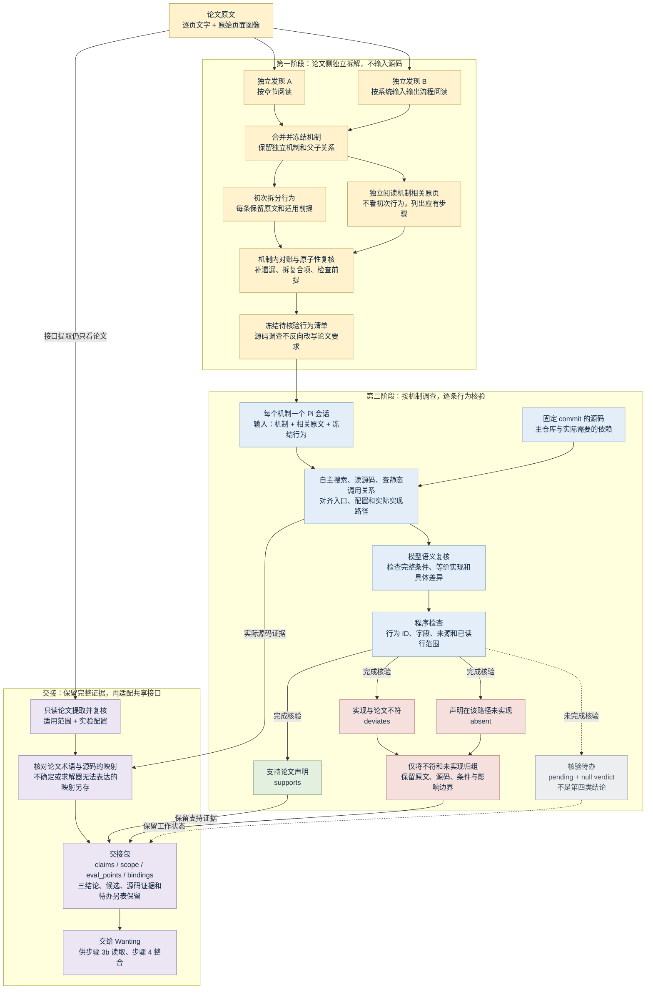

# 论文侧：Zhaopeng

负责步骤 1 的论文语义拆解和步骤 3a 的论文 → 代码静态核验，向 Wanting 提供论文侧输入与差异证据。目标是检查作者承诺的机制行为在指定源码路径中是否兑现。代码发现从冻结的论文行为出发，不先看源码再改写论文命题。

团队分工见[项目总览](../docs/00_project_overview.md)。本页集中说明论文侧的方法、当前结果、交接文件和复跑方式。

## 当前做法流程图



黄色为论文侧，蓝色为源码核验，紫色为接口交接。图中省略了失败修正分支：失败请求和返回会另存，补读或修正也写入新阶段，不覆盖已有记录。当前模块不运行目标系统。

## 实现流程

| 阶段 | 做法 | 实现 |
|---|---|---|
| 独立发现与合并 | 同时给模型论文文字及原始页面；按章节、系统流程分别发现机制，彼此不看结果；合并别名，保留不同职责和父子关系 | [`independent_discovery.py`](src/paperprobe/independent_discovery.py) |
| 拆行为与机制内复核 | 初次拆分后，另一请求不看初次清单，独立列出相关原页步骤；再对账、补漏、拆复合项，冻结行为 | [`mechanism_continuation.py`](src/paperprobe/mechanism_continuation.py) |
| 机制级源码调查 | 每机制一个 Pi 会话，自主列目录、搜索、读固定 Git 源码及静态符号关系；分别对齐主仓库入口与 artifact 路径 | [`prepare_corpus.py`](tools/pi-mechanism-agent/prepare_corpus.py) · [`run-adjudication.mjs`](tools/pi-mechanism-agent/run-adjudication.mjs) |
| 判断与复核 | 先写明论文要求，再比较代码事实、具体差异和等价实现；模型复核语义，程序检查 ID、实际已读引用和字段一致性 | [`conformance.mjs`](tools/pi-mechanism-agent/conformance.mjs) |
| 接口交接 | 导出共享 schema；复核论文范围、实验配置与映射；保留不能表达、证据未闭合和未完成的记录 | [`build_paper_handoff.py`](scripts/build_paper_handoff.py) · [`finalize_handoff.py`](scripts/finalize_handoff.py) |

完成的声明输出 `supports` / `deviates` / `absent`。未完成项用 `review_state=pending, verdict=null` 表示，不增加第四类结论。调度步骤偏离不能直接证明计算结果错误；只检查一个入口也不能证明其他路径缺失。模型判断仍需独立语义复核。

模型为 SoCLaaS `x-test-2` 路由；实际 prompt、返回、工具读取、失败和修正分开留档。没有构建或运行被分析系统。

## 当前交付

当前只有 SparTA 与 FlexPrefill 两篇完成数据验收并入库。其余 MInference、InfiniGen、NNSmith 三篇仍在运行或等待失败恢复，不计为已完成交付；其中 MInference 当前仅接受 11/13 个机制报告，另有 25 条行为缺少已接受报告。

| 项目 | SparTA | FlexPrefill |
|---|---|---|
| 冻结机制 / 行为 | 20 / 206 | 12 / 104 |
| artifact 已完成判断 | 支持 96、不符 55、未实现 48 | 支持 75、不符 10、未实现 11 |
| artifact 待办 | 7 条 | 8 条 |
| 原生论文接口 | 204 claim、26 scope、29 eval point、26 binding | 104 claim、16 scope、23 eval point、24 binding |
| 求解器映射 / 入口导航 | 0 / 26 | 1 条 `tau` 标量映射 / 23 |
| 保留的论文记录 | 2 条引文依据未闭合 claim、2 条撤出评估配置 | 6 条撤出 scope、7 条撤出评估配置 |
| 交接目录 | [SparTA](handoffs/paper-side-v1/sparta/) | [FlexPrefill](handoffs/paper-side-v1/flexprefill/) |

两篇均未运行目标系统，独立人工语义复核仍待完成。机制含父子及重复要求；行为和候选数量不能当作独立 bug 数或准确率。SparTA 现有三个代码侧条件的 scope 仍为 `unknown`；FlexPrefill 只有 `tau` 已建立标量映射，不能据此声称全部范围匹配完成。

源码校验确认引用对应固定 commit 的实际内容，结构检查确认行为 ID 完整。这两项检查不替代语义判断。接口另经来源复核，原模型输出和修订依据均保留在各包的 `review-adjustments.json` 与 `review-notes.json`：SparTA 将“延迟降低 30% / 40%”从错误的稀疏率字段中移出，将 Table 4 张量案例与整模型评估区分；FlexPrefill 将 gamma 开区间保留为文本条件，不把实验 block size 视作穷尽支持范围，也不把 `min_budget=1024` 当全局硬下界。论文中的 `k` 标签保留原样，Table 8 的两种 query 位置分开；仅相关工作描述的 training-free / quantization 不作为系统范围。

FlexPrefill 的[本地完整运行验收摘要](handoffs/paper-side-v1/flexprefill/corpus-acceptance.json)记录 144 次请求、2,602,303 个实际返回 token、138 次工具调用及 10 个被拒收阶段。失败和修正计入记录；这些资源数不是独立样本数。通用验收脚本 [`validate_corpus.mjs`](scripts/validate_corpus.mjs) 需要完整本地运行记录及固定 Git 源码，已对完整 FlexPrefill 运行验过；轻量 checkout 不包含运行它所需的全部外部资产。

## Wanting 如何接入

| 文件 | 用途 |
|---|---|
| [`paper_side.json`](handoffs/paper-side-v1/sparta/paper_side.json) | 共享 schema v0.1.0 的 `claims`、`scope`、`eval_points`、`bindings`，直接传给 `codeside.verify3b --paper-side` |
| [`scope_interpretations.json`](handoffs/paper-side-v1/sparta/scope_interpretations.json) | 范围的条件、单位和评估域解释；有来源的后续修订见 `review-adjustments.json` |
| [`conformance.json`](handoffs/paper-side-v1/sparta/conformance.json) | 全部行为、两种作用域、三类判断和待办，使用 `claim_id` / 行为 ID 关联 |
| [`limitations.json`](handoffs/paper-side-v1/sparta/limitations.json)、[`finding_candidates.json`](handoffs/paper-side-v1/sparta/finding_candidates.json) | 静态差异候选及原模型归组，供步骤 4 去重与审阅 |
| [`source_reads.json`](handoffs/paper-side-v1/sparta/source_reads.json)、[`code_evidence_registry.json`](handoffs/paper-side-v1/sparta/code_evidence_registry.json) | 实际源码片段及仓库、commit、行号；依赖库引用保留独立身份 |
| [`pending_records.json`](handoffs/paper-side-v1/sparta/pending_records.json)、[`inactive_bindings.json`](handoffs/paper-side-v1/sparta/inactive_bindings.json) | 未闭合的论文条目及不传给求解器的映射 |
| [`validation.json`](handoffs/paper-side-v1/sparta/validation.json)、[`RUN_WITH_WANTING.md`](handoffs/paper-side-v1/sparta/RUN_WITH_WANTING.md) | 实际消费者检查结果和接入命令 |

上表文件结构适用于两包；表中链接以 SparTA 为例，FlexPrefill 对应文件位于其交接目录。

入口导航只表示所检查的函数位置，不表示实现支持，也不作为数值参数映射。只有作者明确支持的数值域及确定的标量映射可激活求解器；实验专用数值域不能用于排除未测试输入。不确定映射不会传给当前求解器：它无法表达的文本范围可能被当作无约束条件，直接传入会误判 `in_scope`。

共享 `Verification` 的五类标签回答的是另一种匹配问题，因此没有机械重命名我们的三类判断。Wanting 可先使用原生论文接口，再通过 `conformance.json` 的 ID 和证据整合静态差异。

## 安装与离线验证

以下命令均从本目录 `paperside/` 运行。需要 Python >=3.10 和 Git；Pi 运行需要 Node.js >=20。

```bash
python3 -m venv .venv
.venv/bin/python -m pip install -e '.[team,vision,dev]'

.venv/bin/python scripts/validate_delivery.py
.venv/bin/python -m unittest discover -s tests -v
node --test tools/pi-mechanism-agent/*.test.mjs
```

`team` 安装共享消费者所需的 pydantic、z3-solver、rank-bm25，`vision` 安装 PyMuPDF。离线检查不调用模型、不运行目标系统；缺少未打包的 PDF 或目标仓库时，对应测试会跳过，不能把跳过算作源文件获取验证。安装与验证记录见 [`VALIDATION.md`](VALIDATION.md)。

默认从本模块的祖先目录定位含 `schema/`、`codeside/` 的团队项目，也可设置 `PAPERPROBE_TEAM_REPO` 指向另一个共享消费者 checkout。现有 `codeside/` 和 schema 未因论文侧加入而更改。

## 用固定输入重跑

先安装 Pi 的锁定依赖，下载原论文和固定版本代码；下载过程不执行目标：

```bash
npm ci --prefix tools/pi-mechanism-agent --ignore-scripts --no-audit --no-fund
.venv/bin/python scripts/prepare_team_paper_sources.py --team "${PAPERPROBE_TEAM_REPO:-..}"
```

输入版本来自团队 `data/*/artifact.json` 和本模块的 [`team-reviewed.json`](workstreams/zhaopeng/team-reviewed.json)，会核对 PDF hash 与源码 commit。

在本机 shell 加载已授权的 `SOCLAAS_API_KEY` 后，以下命令会实际调用模型并产生配额消耗：

```bash
.venv/bin/python scripts/run_complete_corpus.py \
  --papers flexprefill minference infinigen nnsmith
```

运行记录写入 `runs/team-complete-v1/`，导出包写入 `handoffs/paper-side-v1/<paper>/`。程序复用已完成调用，不覆盖实际请求和返回。输入、prompt 或代码变更后，应保留旧目录并另建独立运行，不能把新旧条件混成一次实验。

有界恢复见 [`recover_corpus_failed.py`](scripts/recover_corpus_failed.py)：检查失败原因后，在新阶段补读源码或修正结构，原始失败继续保留。它不会用“未读到代码”替代“声明未实现”。源码中的并发和每阶段预算用于控制单次运行；当前结果不构成受控准确率比较。

SparTA 专用的 `prepare_sparta_delivery.py`、`review_sparta_interface.py` 依赖本地归档输入，保留作历史阶段代码，不是全新 checkout 的独立运行入口。冻结的 [SparTA 示例](examples/sparta/)可供离线阅读。

## 仓库中保留什么

入库内容包括实现、测试、配置和版本清单、Pi 源码及 lockfile、轻量 SparTA 与 FlexPrefill 交接记录。分发清单分别见 [SparTA](handoffs/paper-side-v1/sparta/source-distribution.json) 和 [FlexPrefill](handoffs/paper-side-v1/flexprefill/source-distribution.json)。

原 PDF、目标仓库、原始 API 日志、`node_modules`、密钥、ZIP 和大型 HTML 看板留在本地证据包。归档中的绝对路径描述原始运行位置，不是其他机器上的有效链接。早期工作流说明保存在 [`README.legacy.md`](README.legacy.md)，当前交付状态以本页和交接包为准。
