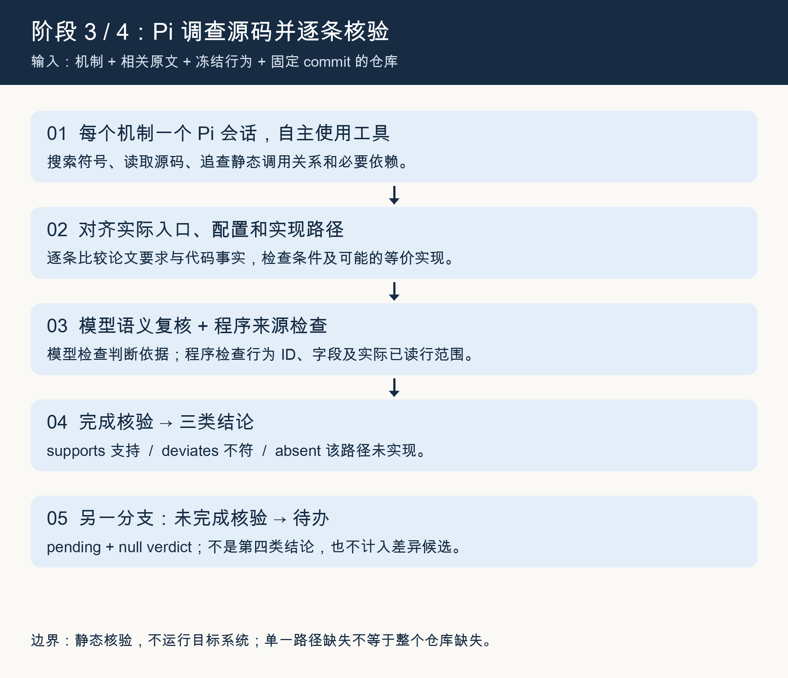
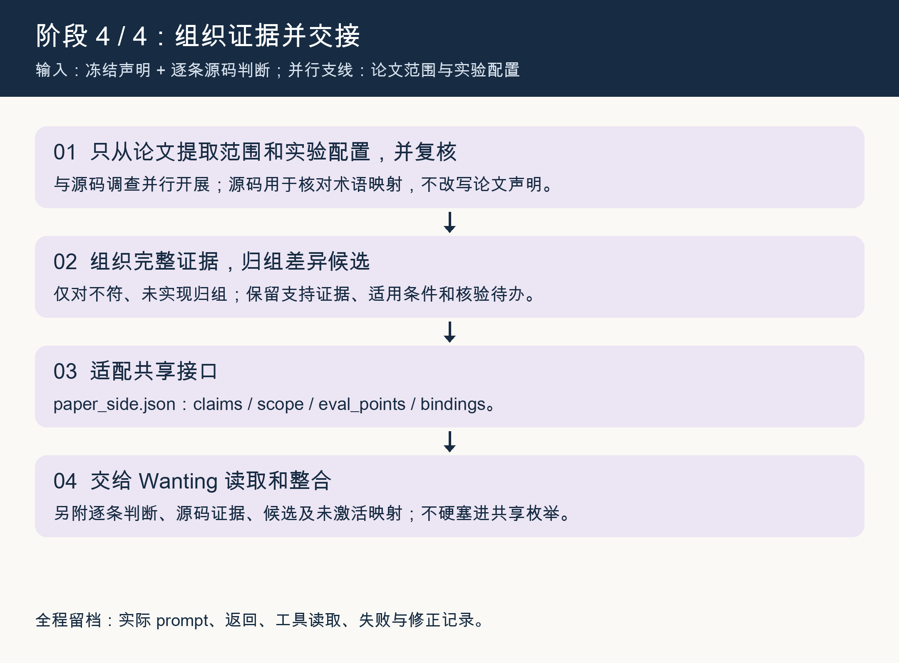

# 论文侧：Zhaopeng

**从论文出发，检查作者说会做的事情，代码是否实现。** 我负责论文语义拆解（步骤 1）和论文 → 代码静态核验（步骤 3a），不运行目标系统。

交接时先看本页；后续 agent 看 [`CLAUDE.md`](CLAUDE.md)；安装、复跑和接口细节看 [`HANDOFF.md`](HANDOFF.md)。

## 先拿什么

结果按论文放在 `handoffs/paper-side-v1/<paper>/`。接手只需先看三个文件：

| 文件 | 用来做什么 |
|---|---|
| `paper_side.json` | 给 Wanting 的论文输入：声明、适用范围、实验配置、代码映射；传给 `codeside.verify3b --paper-side` |
| `conformance.json` | 查看每条论文行为的源码核验结果及依据 |
| `limitations.json` | 查看不符或未实现的静态差异候选，供后续整合和测试 |

源码片段、待办、修订记录也在同目录，需要追溯时再查。[完整文件说明与接入方法](HANDOFF.md#交给-wanting)。

## 当前交付

| 论文 | 机制 / 行为 | 已判断 / 待办 | 交付状态 |
|---|---|---|---|
| [SparTA](handoffs/paper-side-v1/sparta/) | 20 / 206 | 199 / 7 | 已验收并入库 |
| [FlexPrefill](handoffs/paper-side-v1/flexprefill/) | 12 / 104 | 96 / 8 | 已验收并入库 |
| MInference | 13 / 141 | 108 / 33 | 本地运行结束，最终交接包待入库 |
| InfiniGen | 8 / 70 | 59 / 11 | 本地运行结束，最终交接包待验收、入库 |
| NNSmith | 13 / 140 | 113 / 27 | 本地运行结束，最终交接包待验收、入库 |

“已判断 / 待办”按 `artifact` 路径统计。待办没有结论，不视作未实现。当前没有运行目标系统，也尚未完成人工语义验收；这些数字不是 bug 数或准确率。

## 怎么读结果

- **支持 `supports`**：检查到的代码路径满足论文描述。
- **不符 `deviates`**：有相关实现，但行为或适用条件与论文不一致。
- **未实现 `absent`**：在明确检查的路径内，没有实现该行为。

`pending` 表示核验尚未完成，是工作状态，不是第四类结论。阅读差异时同时看论文原文、源码入口和适用条件；单个路径的结论不能直接推广到整个仓库。

## 当前做法流程图

整体顺序：**独立找机制 → 拆行为与机制内复核 → Pi 查源码 → 组织证据并交接**。

以下使用静态 PNG 图片，避免依赖 Mermaid 的富图表渲染。每张图独立呈现一个阶段，点击可查看原图。

### 阶段 1：两次独立找机制，再合并

### 阶段 2：拆行为、补遗漏，再冻结

### 阶段 3：Pi 自主查源码，逐条作判断

### 阶段 4：整理完整证据，交接 Wanting

黄色为论文拆解，蓝色为源码核验，紫色为接口交接。阶段 4 的论文范围与实验配置提取可与前面的拆解、源码调查并行开展，最后汇合成包。当前模块不运行目标系统。

图片的可编辑来源是 [`scripts/render_workflow.py`](scripts/render_workflow.py)，使用 Python 与 Pillow 生成。实际 prompt、返回、工具读取、失败及修正记录仍分别留档。

## 下一位接手者先做什么

1. 使用已入库的 SparTA 或 FlexPrefill，按 [HANDOFF.md](HANDOFF.md) 做离线检查。
2. Wanting 接收 `paper_side.json`，结合 `conformance.json` 和 `limitations.json` 整合候选。
3. 若继续开发，先读 [CLAUDE.md 的下一步](CLAUDE.md#下一步)，完成剩余三篇的交接验收与入库，再处理待办；不必重新调用模型跑一遍。
