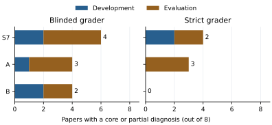

# Paper-side diagnosis on eight source-backed papers

A (one model request) and B (one tool-using agent, up to eight replies) receive the paper and the source packet. S7 maps decisions in the paper, follows an evidence chain in the pinned repository, and delegates a question about one link. It then appends candidates from other stages to the deep report. S7 has a ten-request cap. All three use DeepSeek V4.1 Flash through SoCLaaS. The human reference diagnoses are held back for grading.

Coverage counts papers with at least one core or partial match. The blinded grader sees the final and the reference diagnosis with the workflow identity hidden. The strict grader puts more weight on the operational consequence. Both grade the same 24 final reports.

| Split | Blinded S7 | Blinded A | Blinded B | Strict S7 | Strict A | Strict B |
|---|---:|---:|---:|---:|---:|---:|
| Development | 2/4 | 1/4 | 2/4 | 2/4 | 0/4 | 0/4 |
| Evaluation | 4/4 | 3/4 | 2/4 | 2/4 | 3/4 | 0/4 |
| All eight | 6/8 | 4/8 | 4/8 | 4/8 | 3/8 | 0/8 |



| Split | Paper | S7 | A | B |
|---|---|---|---|---|
| Development | NNSmith | core | miss | core |
| Development | MInference | partial | partial | partial |
| Development | InfiniGen | miss | miss | miss |
| Development | SparTA | miss | miss | miss |
| Evaluation | Prompt Cache | core | core | partial |
| Evaluation | SpinQuant | partial | core | miss |
| Evaluation | KVQuant | partial | miss | partial |
| Evaluation | DX100 | partial | partial | miss |

On the evaluation split, the blinded grader gives S7 credit for KVQuant's fixed protection budget and for part of DX100's dependence across iterations. A gives a core diagnosis on SpinQuant, where S7 receives partial credit. The blind weighted score on this split (two points for core and one for partial) is five for S7 and A, and two for B. Across all eight papers, the blinded core counts are two for S7, two for A, and one for B. The weighted totals are eight, six, and five.

The strict grader puts A ahead on the four evaluation papers. S7's aggregate lead under that grader includes the papers used to develop the workflow. The evaluation papers also informed some prompt revisions. We report one output per workflow and paper in this matrix, and chose the coverage metric after seeing preliminary results. The runs estimate semantic matches to reference hypotheses and leave runtime validation to the test stage. B's SpinQuant final was truncated and contained no candidate, so it counts as a miss in this run. The systems use different call budgets, and the comparison does not estimate the effect of delegation in isolation.

The [blinded archive](../results/matrix.md) and [strict archive](../results-holistic/matrix.md) contain the per-paper grades and final reports. The [complete exploratory matrix](full-matrix.md) documents the wider study.

To regenerate the figure with Matplotlib installed:

```sh
python3 scripts/plot_paper_side.py --output docs/figures/paper-side-coverage.svg
```
